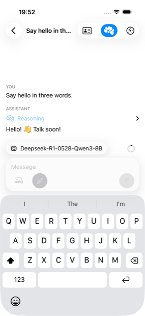
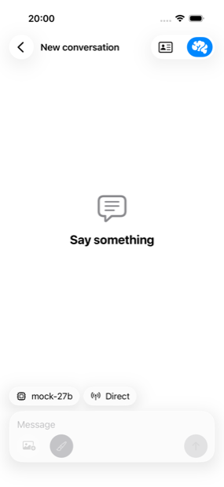
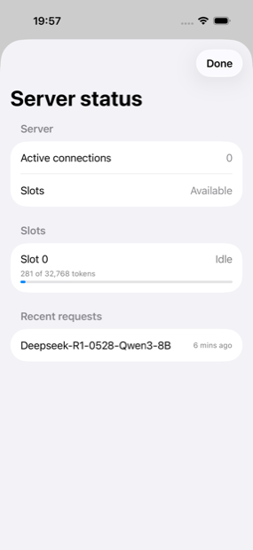
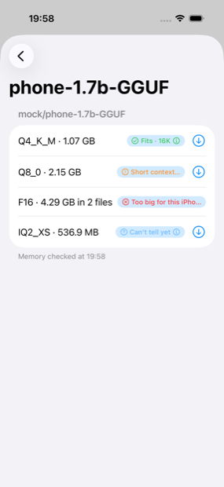
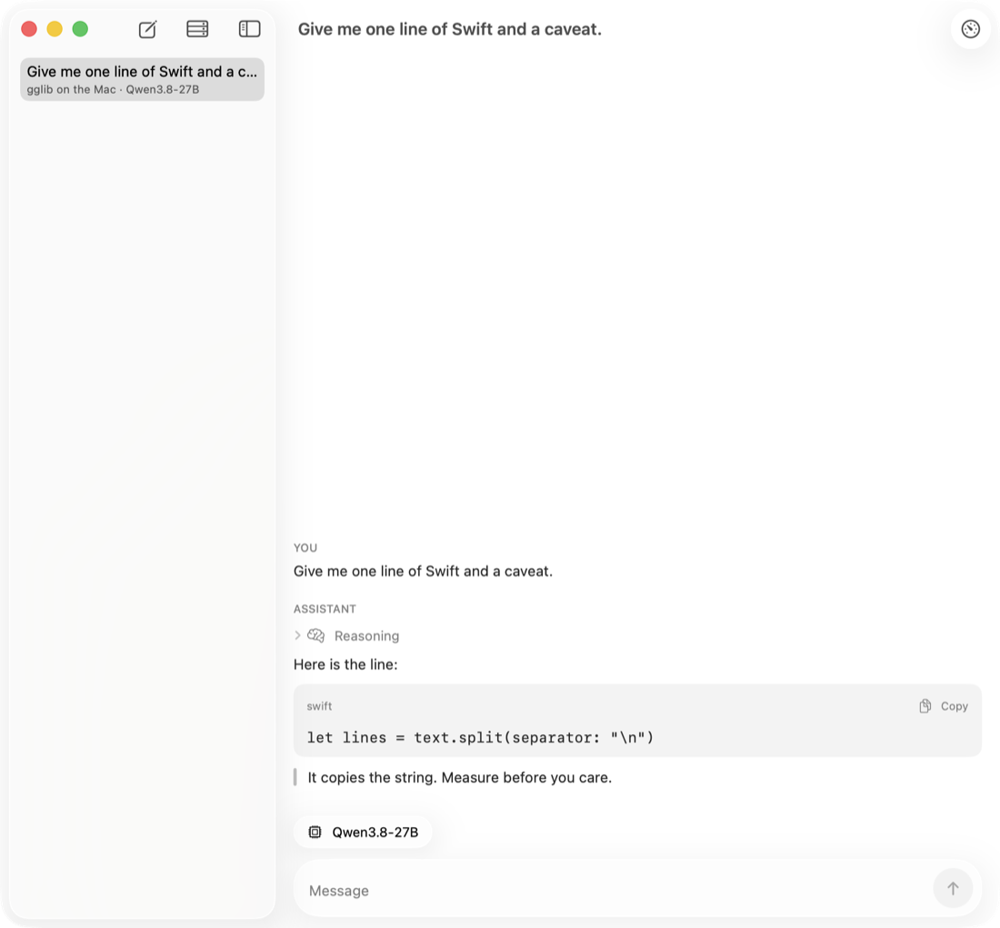

# ggchat

A native Apple chat client for OpenAI-compatible model servers, built so
that a server on your desk at home is reachable from your phone
anywhere, with no port forwarding, no VPN, no account, and no cloud in the
path. That reach comes from [modelpipe](https://github.com/mmogr/modelpipe).
The app is generic: any OpenAI-compatible provider works.
[gglib](https://github.com/mmogr/gglib) is the provider it is built around.

## What it looks like

| Streaming from gglib | A pipe, connected | gglib's server status | Whether a model fits this phone |
|---|---|---|---|
|  |  |  |  |

These are photographs of the app, not mock-ups. The four iPhone ones are
attachments the UI tests take as they walk through it, and `make
screenshots` regenerates them from a test run, so a picture cannot quietly
go stale. The first is a real reply from gglib; the fourth is the on-device
model browser against the mock engine the tests use.

## What it does

- Talks to any OpenAI-compatible server you add by address, and streams
  replies as markdown with collapsed reasoning, a stop button, and Continue
  when a reply stops early.
- Reaches a machine at home through a pipe: paste the pairing string it
  showed, or scan its QR code on an iPhone or iPad. The six-digit code is
  spent once, for a key minted for this device alone. No VPN, no account.
- Shows gglib's own server status when the server is gglib: slots, context
  in use, recent requests, the MCP servers a paired Mac offers.
- Picks up where it left off: going to the background hangs up every pipe,
  and a reply gglib was writing is read on from where it stopped when the
  app comes back.

Every behaviour, as a claim that names the test proving it, is in
[docs/what-is-true-today.md](docs/what-is-true-today.md).

## Getting it

There is no App Store build yet. Open `App/ggchat.xcodeproj` in Xcode 26
or later and run it on your phone, or `make build-app` from a terminal.
[docs/contributing.md](docs/contributing.md) has the rest: tests, the live
walks against a real server, layout, how releases are cut.

## The rest of the set

ggchat is the phone. [gglib](https://github.com/mmogr/gglib) is the server
it is built around: a library of GGUF models served through llama.cpp as
one OpenAI-compatible endpoint. [modelpipe](https://github.com/mmogr/modelpipe)
is the reach: the end-to-end encrypted peer-to-peer connection that puts
that endpoint on this phone with no VPN and no account.

## Licence

ggchat is licensed [AGPL-3.0-only](LICENSE), as gglib is. Anyone may use,
modify and redistribute it, commercially or not, under those terms:
distributing it, or letting users reach a modified copy over a network,
means offering them the corresponding source under the same licence.

The author, [@mmogr](https://github.com/mmogr), holds the copyright in
ggchat and in gglib, and so can also distribute ggchat under terms of
their own. The builds the author ships on the App Store, or with gglib's
code linked into them, go out under those terms; the AGPL is what governs
everyone else's use.
